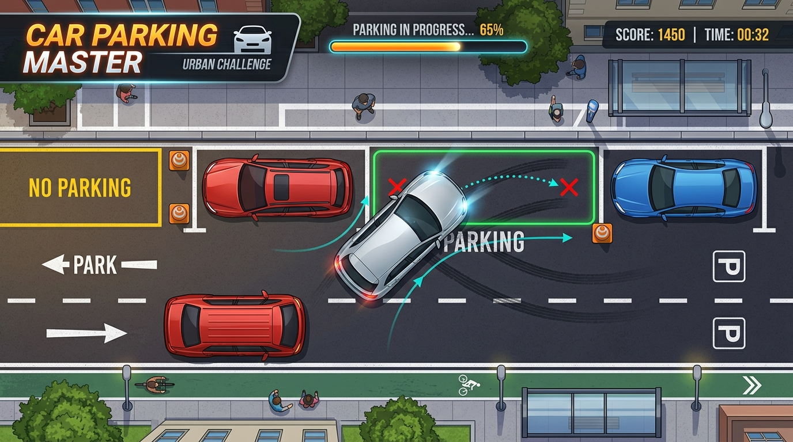

# 🚗 Parking Simulator 2D - Simulador de Baliza

<p align="center">
  <a href="https://github.com/leonardoconstantino/parking-simulator/actions/workflows/deploy.yml">
    
  </a>
  
  
  
  
  
</p>

<p align="center">
  <strong>Um simulador de estacionamento 2D realista com física precisa de esterçamento, sistema de CNH e pontuação de infrações, pedestres reativos, efeitos climáticos e editor de fases customizadas!</strong>
</p>

<p align="center">
  🎮 <a href="https://leonardoconstantino.github.io/parking-simulator/"><strong>Clique aqui para Jogar Agora no GitHub Pages</strong></a>
</p>

---

## 📸 Demonstração

<p align="center">
  
</p>

---

## ✨ Principais Recursos

- 🏎️ **Física de Direção Realista**: Simulação com modelo cinemático de bicicleta (Ackerman), aceleração suave, ré com relação de marcha, inércia, arraste de pneus e freio de mão funcional com derrapagem.
- 🪪 **Sistema de CNH Viva**: Pontuação oficial de infrações inspirada no CTB. Colisões com guias, quase-atropelamentos, impaciência de trânsito e estouro do tempo regulamentar penalizam a sua carteira até a suspensão ou cassação.
- 🛠️ **Editor de Fases Avançado**: Crie, edite, teste e compartilhe mapas próprios. Adicione obstáculos (carros, pilares, guias, obras), defina ladeiras com gravidade real (`slope`), ajuste a tolerância milimétrica da vaga e crie pedestres patrulheiros.
- 🤖 **Compatível com LLMs**: Exporte e importe fases em formato JSON padronizado. Consulte o [CUSTOM_MAPS_GUIDE.md](./CUSTOM_MAPS_GUIDE.md) para gerar desafios inéditos usando modelos de inteligência artificial.
- 🚶 **Pedestres com IA & Personalidades**: Transeuntes caminham pelo mapa em trajetos com waypoints e reagem às suas manobras com diálogos contextuais (ansioso, irônico, expert, dramático).
- 🌧️ **Ciclo Dia/Noite & Efeitos Climáticos**: Fases ambientadas pela manhã, tarde, crepúsculo e noite, além de chuva torrencial com perda de aderência e pista escorregadia.
- 🔊 **Áudio Dinâmico Web Audio API**: Sons procedurais sintetizados diretamente no navegador: rotação do motor, buzina, arrancadas, derrapagens, colisões e som de chuva.
- 👻 **Carro Fantasma (Ghost Replay)**: Acompanhe a melhor manobra registrada anteriormente como um holograma para aperfeiçoar seu tempo e precisão.
- 📱 **100% Responsivo e Mobile Ready**: Controles na tela (volante virtual, pedais e botões táteis) para jogar perfeitamente em smartphones e tablets.

---

## 🎮 Controles

| Ação | Teclado (PC) | Mobile / Touch |
| :--- | :--- | :--- |
| **Acelerar (Frente)** | <kbd>W</kbd> ou <kbd>↑</kbd> | Pedal Acelerar (D) |
| **Marcha Ré / Frear** | <kbd>S</kbd> ou <kbd>↓</kbd> | Pedal Ré (R) |
| **Virar para a Esquerda** | <kbd>A</kbd> ou <kbd>←</kbd> | Botão Direção Esquerda |
| **Virar para a Direita** | <kbd>D</kbd> ou <kbd>→</kbd> | Botão Direção Direita |
| **Freio de Mão** | <kbd>Espaço</kbd> | Botão Freio de Mão |
| **Buzina** | <kbd>C</kbd> | Botão Buzina |
| **Reiniciar Manobra** | <kbd>R</kbd> | Botão Reiniciar no HUD |
| **Mutar / Desmutar Áudio** | <kbd>M</kbd> | Botão de Som no Cabeçalho |

---

## 💻 Como Rodar Localmente

### Pré-requisitos
- [Node.js](https://nodejs.org/) versão 18+ ou 20+
- [Git](https://git-scm.com/)

### Passo a Passo

1. **Clone o repositório:**
   ```bash
   git clone https://github.com/leonardoconstantino/parking-simulator.git
   cd parking-simulator
   ```

2. **Instale as dependências:**
   ```bash
   npm install
   ```

3. **Inicie o servidor de desenvolvimento:**
   ```bash
   npm run dev
   ```
   Acesse `http://localhost:3000` (ou a porta exibida no terminal) no seu navegador.

4. **Gerar build de produção localmente:**
   ```bash
   npm run build
   npm run preview
   ```

---

## 🚀 Deploy Automático no GitHub Pages

Este projeto utiliza **GitHub Actions** para automação de CI/CD. Toda vez que um commit é enviado para as branches `main` ou `master`, o workflow [`.github/workflows/deploy.yml`](./.github/workflows/deploy.yml) é disparado:

1. Clona o repositório e configura o ambiente com Node.js 20.
2. Instala as dependências e executa a build otimizada passando `GITHUB_ACTIONS=true` (garantindo o `base: '/parking-simulator/'` no Vite).
3. Publica a pasta estática `/dist` diretamente no GitHub Pages através das actions oficiais `actions/upload-pages-artifact` e `actions/deploy-pages`.

---

## 📄 Licença

Este projeto está distribuído sob a licença [Apache 2.0](LICENSE).
Sinta-se à vontade para clonar, estudar, criar novas fases e contribuir!
